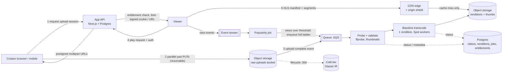

# CreatorHub: Video Upload, Processing & Streaming Design

**Principle:** keep heavy bytes off our servers, do expensive work lazily, and let the CDN do most of the serving.

## Architecture diagram

## A. Upload

**Do video files go through the app server? No.** Multi-GB bodies would hold connections and memory, hit proxy and serverless timeouts, couple upload capacity to API capacity, and we would pay for compute and egress twice. The app server only does the cheap, authenticated parts.

Flow:

1. `POST /api/uploads` (authenticated) validates declared type and size, checks quota and creator state, creates a `video` row in `uploading` status, then starts an S3 multipart upload. The response is a set of presigned part URLs, each scoped to this key, a content-length range and a short expiry (about 1 hour; refreshed on demand).
2. The client slices the file into **8-16 MB parts** (5 MB minimum), uploads **3-4 parts in parallel**, retries each part with backoff, and records completed parts locally. Use smaller parts and lower parallelism on mobile or metered connections.
3. **Interrupted uploads:** on reload or network change the client calls `ListParts` (via our API) and uploads only the missing parts. Abandoned multipart uploads are aborted by a lifecycle rule after 7 days so they don't accrue storage cost. tus/Uppy implement this protocol if we prefer not to write it.
4. **Progress** is computed from bytes confirmed per part. The UI shows part count, percentage, and cancel/resume.
5. **Validation:** cheap client checks (extension, size) give fast feedback; the *real* validation is server-side after upload: size, then `ffprobe` to confirm a decodable video stream, duration limits, and a codec/container allow-list. Never trust the extension or `Content-Type`.
6. **Mobile:** resumable parts survive tab suspension and network switches (Wi-Fi to LTE). We warn on cellular for large files and keep the draft saved so the creator can finish later.

The demo's "Resume upload" button illustrates this: a failed upload resumes from the last completed part rather than restarting.

## B. Processing

Event-driven pipeline: object-created event, then queue, then stateless workers (containers on spot/preemptible capacity). Every stage is **idempotent** (keyed by `video_id + stage + input hash`), so a retry or duplicate event never double-processes or double-bills.

| Stage | What happens | Cost control |
|---|---|---|
| Validate + probe | `ffprobe`: codec, resolution, fps, duration, rotation, audio. Reject corrupt or oversized files early. | Fails fast before any transcode spend. |
| Thumbnails | 3 candidate frames plus a small sprite for scrubbing. A creator-uploaded thumbnail always wins. | Single decode pass, run with probe. |
| **Baseline rendition** | **One** 720p H.264 + AAC rendition as HLS/CMAF segments (4-6 s, keyframe-aligned). If the source is already compliant (H.264/AAC, sensible bitrate) we **remux without re-encoding**. Never upscale: a 480p source gets 480p only. | The cheapest path that plays everywhere. |
| **Full ladder (on demand)** | 240p-1080p (and 1440p/4K only if the source warrants), optionally HEVC/AV1 for the very hottest content. Triggered by the popularity job, not at upload. | Pay only for videos people actually watch. |
| Dedupe | A content-hash match with an existing upload reuses renditions. | Avoids duplicate re-uploads. |

**Failure handling:** retries with exponential backoff, then a dead-letter queue and a `processing_failed` status with a human-readable reason shown to the creator (e.g. "unsupported codec") plus a one-click retry. Creators can't publish a video that isn't `ready`.

**Managed vs self-run:** for the MVP use a managed transcoder (MediaConvert, Cloudflare Stream, Mux) for speed of delivery. At the scale below, FFmpeg on spot workers is roughly 10x cheaper per minute, so move once transcoding spend justifies the operational work. The estimate below assumes self-run.

## C. Storage

| Data | Where | Why |
|---|---|---|
| Original video | Object storage `raw` bucket (S3 / R2), private, encrypted at rest. Lifecycle: Standard, then **Glacier Instant Retrieval after 30 days**. | Cheap, durable, and required to re-transcode later (new codecs, ladder promotion). Instant retrieval keeps promotion fast. |
| Processed video | Separate `renditions` bucket (Standard / Intelligent-Tiering), private, readable only by the CDN. Versioned paths: `/v/{id}/{rev}/{rung}/seg_00001.m4s`. | Versioned paths allow immutable year-long caching. A private bucket means no public URL exists. |
| Thumbnails | Same renditions bucket under `/t/{id}/`, CDN-cached. | Small, hot, trivially cached. |
| Metadata | **Postgres** (managed): `creators`, `videos`, `renditions`, `jobs`, `purchases`, `entitlements`. | Relational integrity for money and access; needs transactions. |
| Counters / hot cache | Redis (view counts, rate limits, short-lived playback sessions). | Cheap writes, flushed to Postgres in batches. |
| View/analytics events | Event stream into a columnar store (ClickHouse / BigQuery) once volume warrants. | Don't write 10M+ rows a month into the transactional DB. |

## D. Streaming & delivery

- **HLS/CMAF (fMP4)** with adaptive bitrate. It is universally supported (native on Safari/iOS, `hls.js` elsewhere) and works with plain object storage plus a CDN.
- **CDN with origin shield:** viewers hit the nearest edge; misses collapse at one shield location, so the origin sees one fetch per segment worldwide instead of one per edge.
- **Caching:** segments use `Cache-Control: public, max-age=31536000, immutable`; manifests use a short TTL (60 s, or long once the video is final); thumbnails use a long TTL.
- **Startup time:** start at a low or mid rung, then ramp up. Keep the first segment small, preconnect to the CDN, and fetch the manifest and first segment in parallel. Aim for time-to-first-frame under about 2 s.
- **Seeking:** segment-aligned keyframes mean a seek is just a different segment request; a thumbnail sprite gives scrub previews.
- **Adaptive quality and bandwidth:** ABR picks the rung from measured throughput; cap resolution by player size (no 1080p on a 360px phone). Newer codecs (HEVC/AV1) cut the bytes for hot content by roughly 30-50%.
- **Popular vs long tail:** hot content stays warm at the edge for free. Long-tail content may miss the cache and pay a first-byte penalty from origin, which is acceptable because few people watch it. Optionally pre-warm new releases from large creators.
- **Different countries:** one global CDN with PoPs in each region covers most cases. If a region has poor coverage, add a second CDN there (multi-CDN, steered by real-user latency data) rather than replicating storage everywhere.

## E. Paid content protection

Goal: a copied URL must be useless to someone else, and useless later. Layers:

1. **Authentication and authorization first.** The player calls `POST /api/videos/:id/playback` with the viewer's session. The server checks for an **active entitlement** (purchased, not refunded) for that user and video.
2. **Short-lived signed credentials.** If entitled, the server issues a **CDN signed cookie** (preferred for HLS because it covers the manifest *and* every segment) scoped to `/v/{id}/*`, expiring in about 2-6 hours, or signed URLs where cookies aren't possible. The player refreshes before expiry.
3. **Bound and rate-limited.** Tokens carry user/session ids so abuse is traceable; the playback endpoint limits concurrent streams per account (e.g. 2-3), which stops one purchase being streamed by many people at once.
4. **Private origin.** The bucket accepts requests only from the CDN, so there is no permanent URL to leak. Revoking an entitlement (refund) stops new tokens immediately; existing ones die on expiry.
5. **Optional edge check** (CloudFront Function / Worker) can validate a JWT or add IP/ASN binding for high-value content.

Not covered (by design, per the brief): DRM and screen recording. Visible or forensic watermarking with the viewer's id is a cheap deterrent to add later.

**Payment succeeds but video authorization fails:** purchases are a small state machine (`authorized -> entitled -> captured`). We create the entitlement in the same transaction as the purchase record, or via an outbox with retries. The UI says "Purchase confirmed. Unlocking your video..." and retries playback authorization automatically. A reconciliation job finds "paid but not entitled" records and fixes them; if it can't within a few minutes, the payment is voided or refunded automatically and the user is told. Users are never charged for something they can't watch.

## F. Cost efficiency

| Area | How we avoid waste |
|---|---|
| Transcoding | One baseline rendition at upload; the full ladder only for content that earns it; remux when the source is already compliant; never upscale; skip duplicates; spot instances. |
| Compute | Event-driven workers scale to zero; no always-on transcoding fleet; the app API stays small and stateless because it never touches video bytes. |
| Storage | Lifecycle rules move originals to cold storage; abort stale multipart uploads; delete upper rungs of videos with no views for 90+ days (regenerate from the original on demand); per-creator quotas. |
| CDN / bandwidth | High cache-hit ratio via immutable segments and origin shield; ABR plus resolution caps; modern codecs for the hottest content; negotiated egress pricing or an alternative CDN. |
| Repeated requests | Long TTLs on segments and thumbnails; manifest caching; metadata cached in Redis; the client uses backoff (or server-sent events) for processing status instead of tight polling. |

### Should a 5-view video be treated like a 500,000-view video? No.

Costs are asymmetric. Encoding a full ladder costs roughly the same per video whether it is watched 5 times or 500,000. For 5 views, extra renditions are pure waste; a single baseline rendition plays everywhere at essentially zero marginal cost. For 500,000 views, **bandwidth is the dominant cost**, so spending more compute once (full ladder, tuned per-title encodes, HEVC/AV1) is repaid many times over by smaller bytes per view and better quality. So we tier by observed demand:

- **Cold tier (default):** baseline rendition, cold-stored original, cached opportunistically.
- **Warm tier** (e.g. more than 100 views in 7 days): generate the full ladder.
- **Hot tier** (e.g. more than 10k views a week): per-title encoding, HEVC/AV1, pre-warmed edge, possibly multi-CDN.
- Demotion runs on a schedule, so tiers follow demand rather than staying forever.

---

# Scale & cost challenge

**Assumed scale:** 100k creators, 1M videos, 10M views a month.

## 1. What scales easily?

- **Uploads:** go straight to object storage; effectively unlimited, with no app-server load.
- **Object storage and CDN delivery:** managed and horizontally scalable.
- **Processing workers:** stateless consumers of a queue, so scaling is "add workers", and they scale to zero when idle.
- **App API:** stateless and horizontally scalable behind a load balancer.

## 2. Likely bottlenecks

- **Postgres write hotspots** (view counters, job status updates): fix with Redis counters plus batched flushes, read replicas, partitioning.
- **Transcode backlog** after a burst (e.g. a creator importing 500 videos): watch queue depth and age, add priority lanes (new publishes first) and per-creator rate limits.
- **The playback-authorization endpoint** sits on the critical path of every play: keep it light, cache entitlements in Redis, and use signed cookies so segment requests never hit the API.
- **Origin shield / cache misses** for the long tail in far-away regions.

## 3. What gets expensive?

**CDN egress is the largest cost by far, and it grows linearly with views.** Second is storage (grows with the catalogue, mitigated by tiering), then observability and managed Postgres. Transcoding is surprisingly small *because* of lazy ladders.

## 4. What to monitor

- **Upload:** session start-to-complete rate, part-retry rate, abandoned uploads, median time to complete.
- **Processing:** queue depth and oldest-message age, job duration, failure rate by reason, cost per transcoded minute, DLQ size.
- **Delivery:** cache-hit ratio, origin egress, time-to-first-frame, rebuffer ratio, 4xx/5xx rate, bitrate distribution, all by region.
- **Business/security:** playback-authorization failures, signed-URL 403s, concurrent-stream violations, purchases without entitlements (should be about 0).
- **Cost:** daily spend by category with anomaly alerts; GB served per view.

## 5. What changes as traffic grows

- Move from managed transcoding to self-run spot FFmpeg (if not already); add hardware encoders for hot-tier AV1.
- Negotiate committed CDN pricing, then add a second CDN for cost and resilience (steer by price and performance).
- Split analytics onto an event pipeline plus a columnar store; add read replicas and partitioned tables in Postgres.
- Promote on early view *velocity*, not just totals, and delete cold upper rungs.
- Regional processing buckets if creators concentrate in specific regions.

## Rough monthly cost estimate (steady state at the scale above)

**Assumptions** (rounded; adjust to taste):

- Average video: **6 min**, original **~200 MB**. Steady state: about **100k new uploads a month** (1M catalogue).
- Baseline 720p is about **67 MB** per video; a full ladder is about **200 MB** for the roughly 5% of videos that are warm/hot.
- **10M views a month**, average **3 min watched** at a blended **~1.8 Mbps**, which is about **40 MB per view, or ~400 TB a month** of egress.
- CDN cache-hit ratio of 90% or better; negotiated/committed CDN price of about **$0.03/GB** blended (list price is roughly double).
- Self-run FFmpeg on spot instances; AWS-style pricing. A Cloudflare/Bunny-style CDN would cost less.

| Item | Basis | $/month |
|---|---|---:|
| **CDN bandwidth** | 400 TB x ~$0.03/GB | **~12,000** |
| Storage: originals | ~180 TB cold ($0.004/GB) + ~20 TB hot ($0.023/GB) | ~1,200 |
| Storage: renditions + thumbnails | ~77 TB x $0.023/GB | ~1,800 |
| Transcoding: baseline | 600k min/month at ~2x realtime, about 20k vCPU-hours on spot | ~300 |
| Transcoding: promoted ladders | ~5k videos/month x 5 rungs | ~200 |
| App compute (API, worker control plane) | A few small containers plus a load balancer | ~500 |
| Postgres (managed, HA) + Redis | Multi-AZ medium instance plus cache | ~600 |
| Queue, events, KMS, WAF | | ~300 |
| Observability / logging | Metrics, logs, RUM | ~600 |
| **Total** | | **~$17,500** |

**Range: about $10k-$25k a month** (low end with a cheaper CDN, high end at list CDN prices or a longer average watch time). That is about **$0.0017 per view**, or roughly **$1.70 per 1,000 views**.

**Largest cost as we scale: CDN egress** (about 70% of spend). It scales with views x minutes watched x bitrate, and none of those shrink on their own. Levers in order of impact: committed or multi-CDN pricing, better codecs for hot content, and sensible ABR caps. Storage is second and grows with catalogue size even if nobody watches, which is why originals go cold and unused renditions get pruned.
